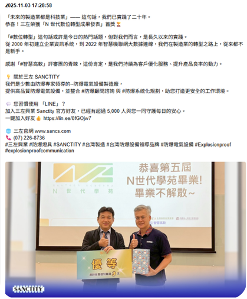

# Facebook 粉絲專頁貼文爬蟲與網頁展示

## 專案介紹

本專案使用 Python 蒐集 Facebook 粉絲專頁的貼文資料，並透過 Flask 製作簡單的展示網頁，方便瀏覽及整理貼文內容，作為公司行銷資料蒐集與電子報素材的參考。

## 使用技術

Python

Facebook SDK

Pandas

Flask

GitHub Actions

Render

## 主要功能

貼文資料蒐集：使用 Facebook API 取得粉絲專頁貼文。

資料整理：使用 Pandas 整理貼文發布時間、文字內容、圖片及原始貼文連結。

網頁展示：使用 Flask 將蒐集到的貼文資料呈現在網頁上。

定時更新：透過 GitHub Actions 設定每小時執行一次，定期更新貼文資料。

## 專案畫面

## 專案成果

完成 Facebook 貼文資料蒐集、整理及網頁展示，並設定 GitHub Actions 定時更新資料，減少人工蒐集與更新的工作。

## 注意事項

原網頁曾部署於 Render，目前因免費方案使用額度限制，已停止服務。專案程式碼仍可於本 GitHub 儲存庫查看。
